<a href="https://nk.tools">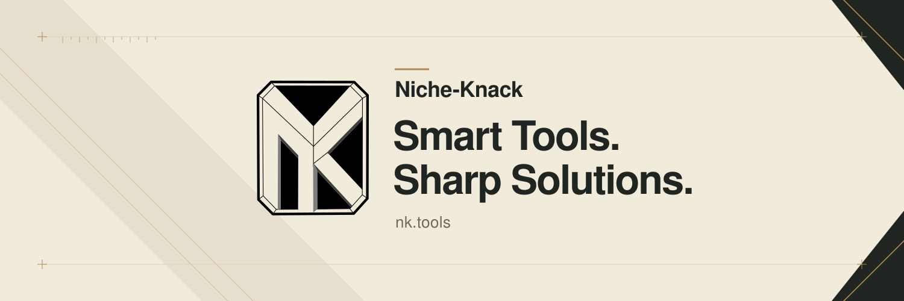</a>

One engineer in Ohio, making apps for narrow needs. An app isn't done when it works; 
it has to be a pleasure to use. Local files and useful tools come first.

<a href="https://nk.tools/apps">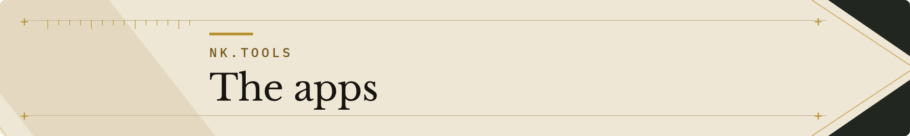</a>

Explore the apps and request beta access at <a href="https://nk.tools">nk.tools</a>. Lamplighter and Breach are free forever; their pages list current downloads and platform availability.

<a href="https://nk.tools/pocket-nerd">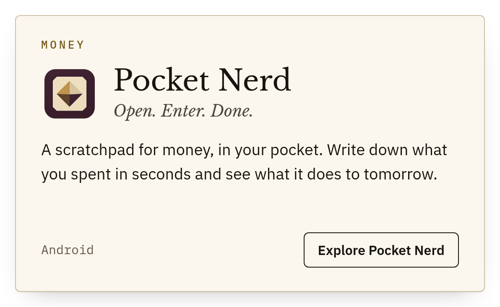</a>
<a href="https://nk.tools/ledgerkeep">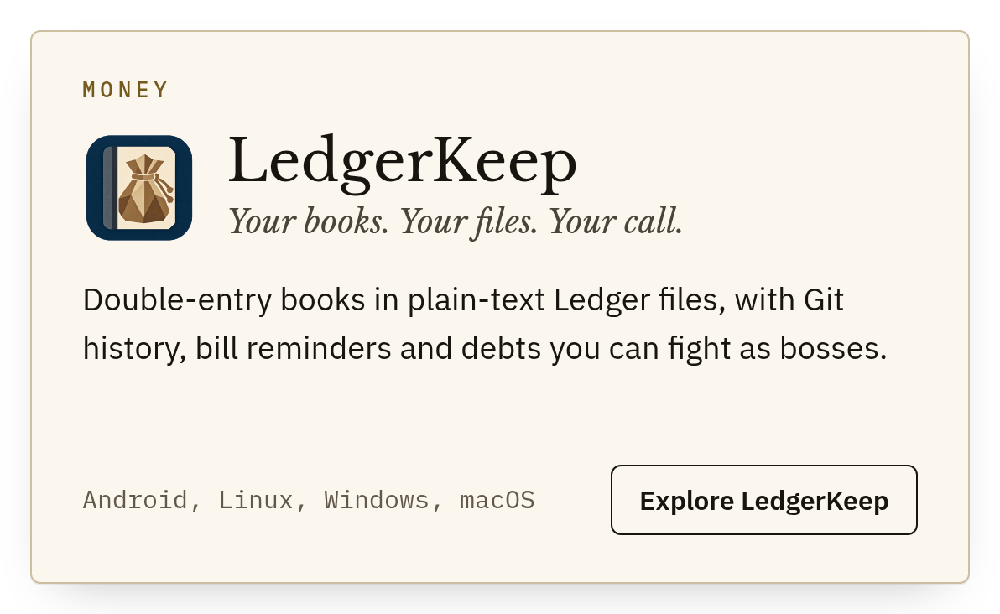</a>

<a href="https://nk.tools/clip-dr">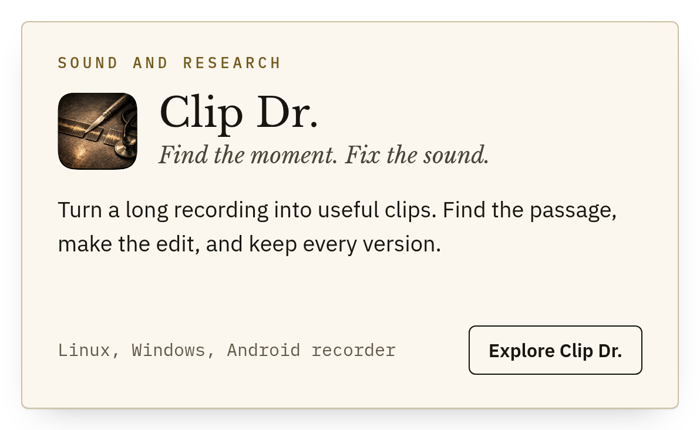</a>
<a href="https://nk.tools/rabbit-trail">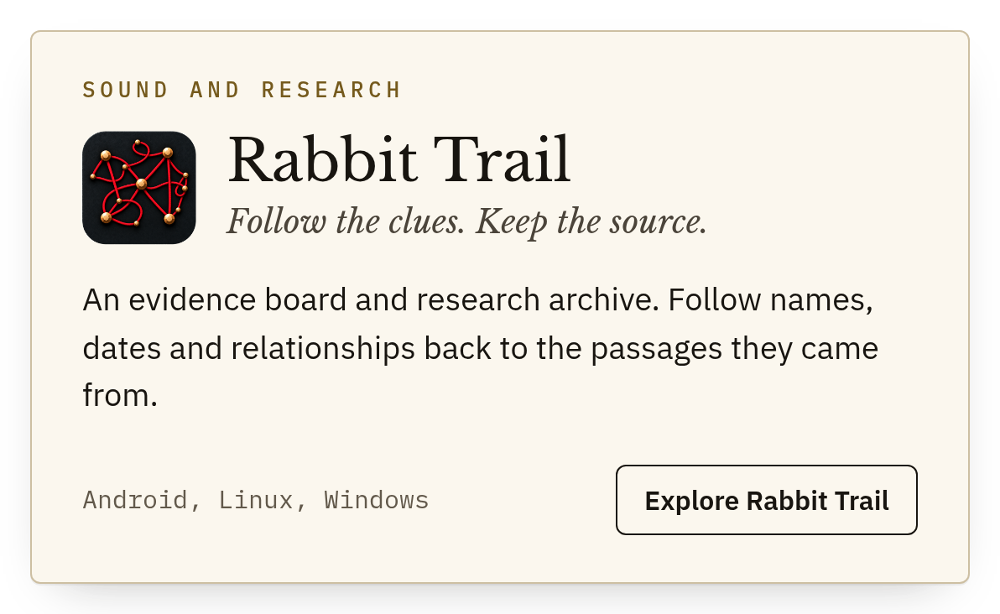</a>

<a href="https://nk.tools/choirboy">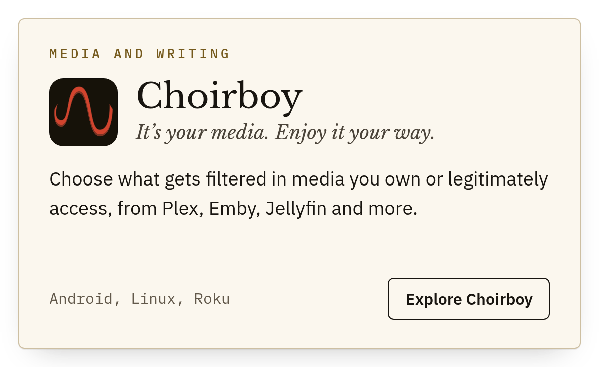</a>
<a href="https://nk.tools/euphonics">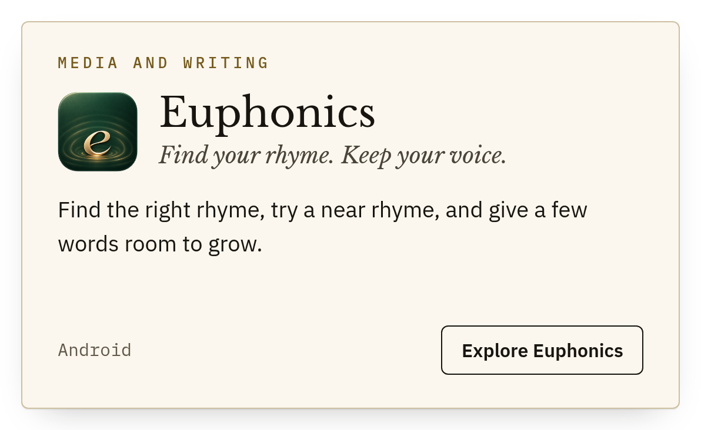</a>

<a href="https://nk.tools/lamplighter">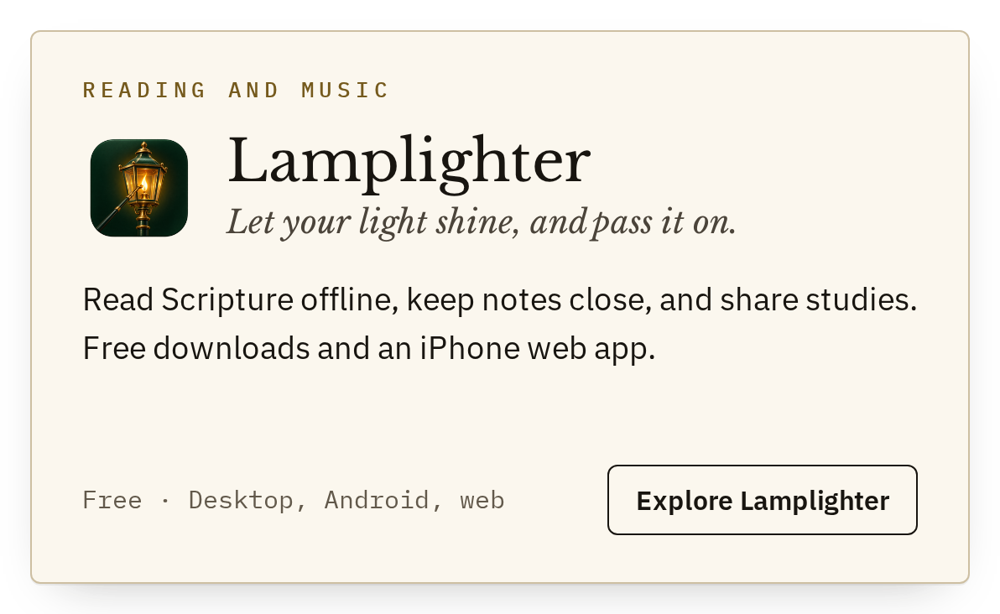</a>
<a href="https://nk.tools/riffwright">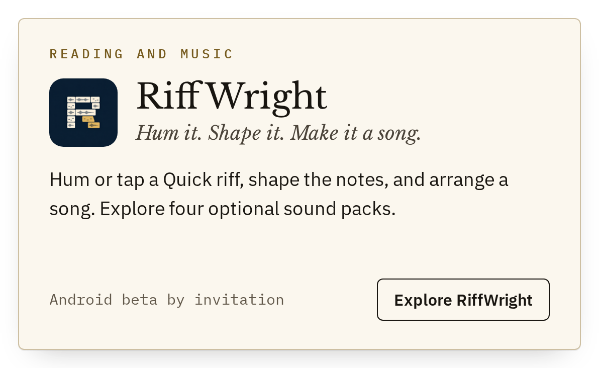</a>

<a href="https://nk.tools/breach">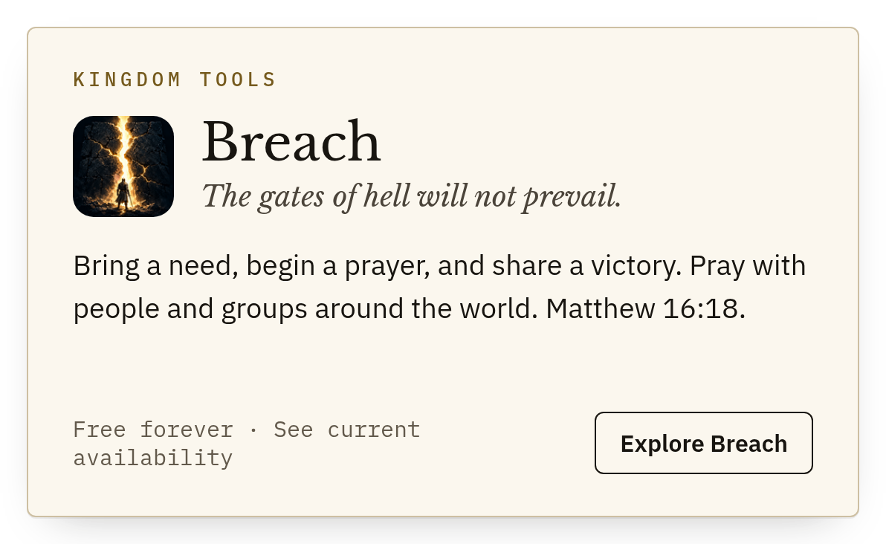</a>

<a href="https://github.com/Niche-Knack-Apps?q=&type=public">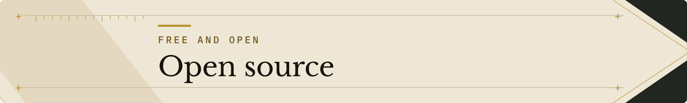</a>

<a href="https://github.com/Niche-Knack-Apps/z9s">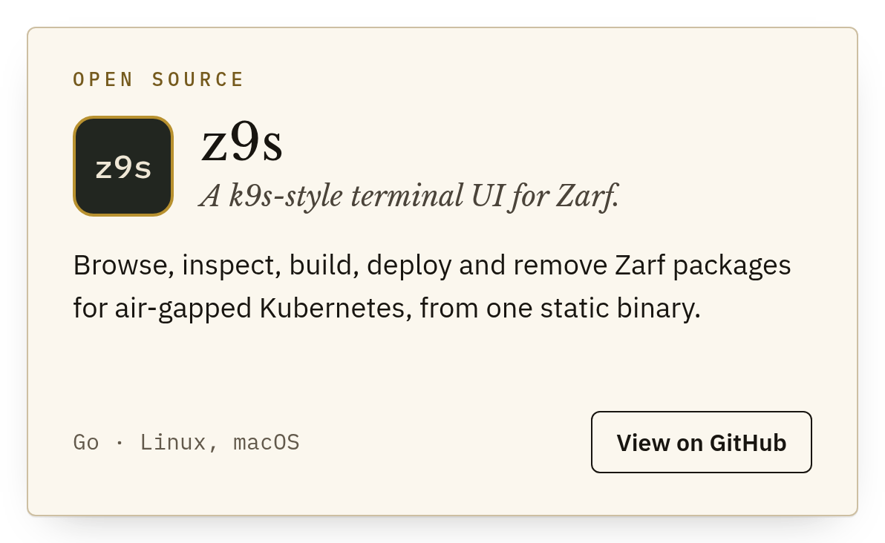</a>
<a href="https://github.com/Niche-Knack-Apps/nines">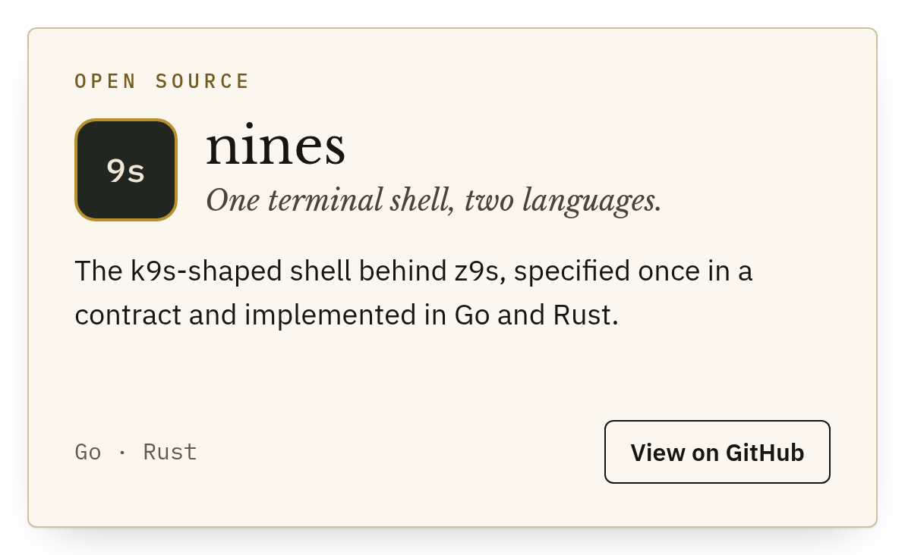</a>

<a href="https://github.com/Niche-Knack-Apps/luddite">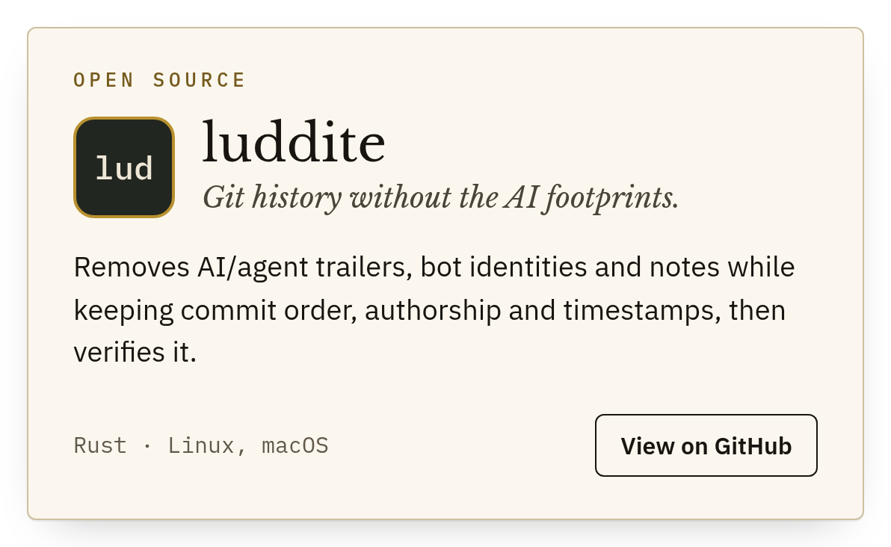</a>
<a href="https://github.com/Niche-Knack-Apps/stenographer">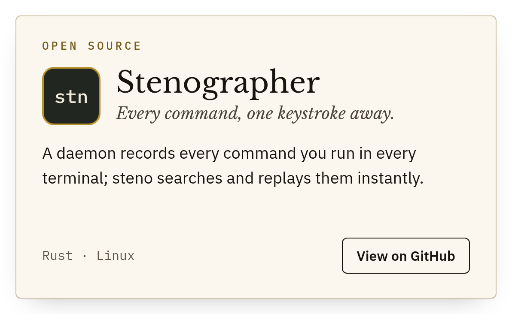</a>

<a href="https://github.com/Niche-Knack-Apps/lamplighter">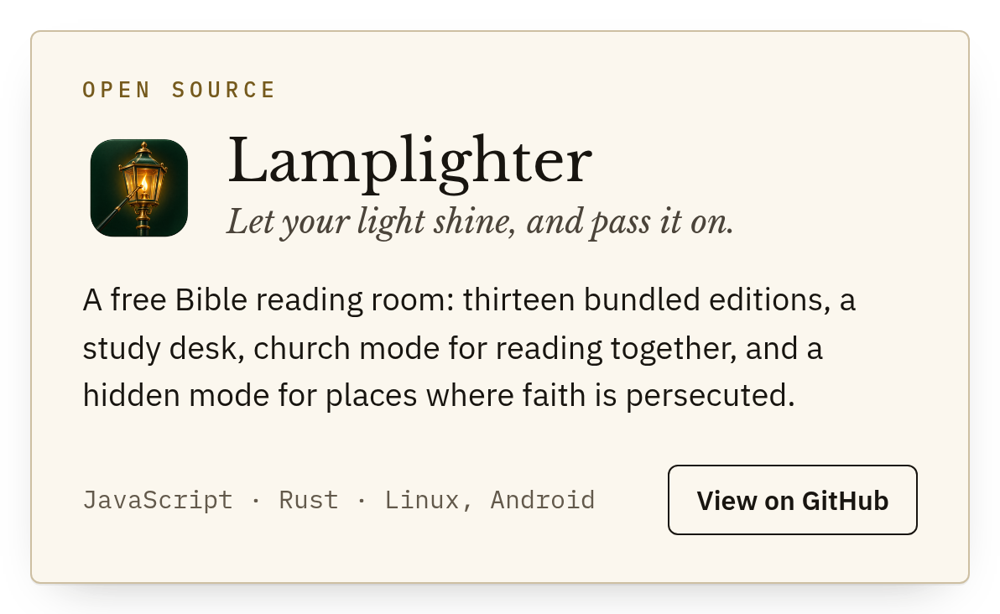</a>
<a href="https://github.com/Niche-Knack-Apps/lamplighter-formats">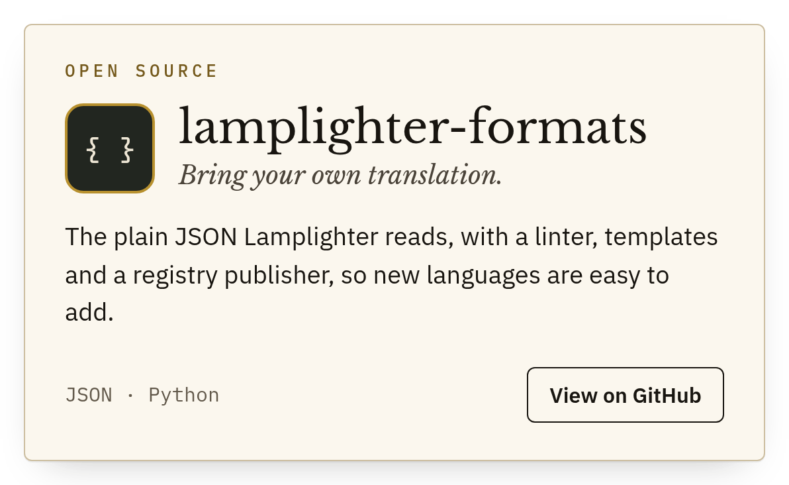</a>

Public commits are signed with the Niche-Knack key <code>62BE F1F2 9220 6C3D 5B0D 799B 79FB 9434 BEFF BCBC</code>.

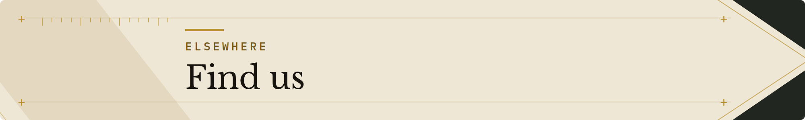

<a href="https://nk.tools">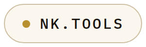</a>
<a href="https://nk.tools/journal/">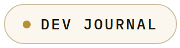</a>
<a href="https://x.com/nicheknackapps">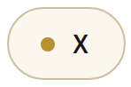</a>
<a href="https://www.facebook.com/1434370439750765">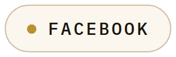</a>
<a href="https://www.instagram.com/nicheknackapps/">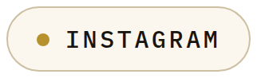</a>
<a href="https://www.pinterest.com/nicheknackapps/">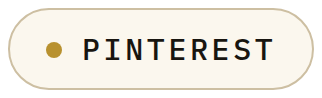</a>

Really believe in what we're building and want to contribute to its development? 
<a href="https://buymeacoffee.com/nicheknack">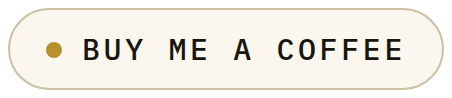</a>

Smart Tools. Sharp Solutions. · Niche-Knack Apps LLC · <a href="mailto:support@nk.tools">support@nk.tools</a>

